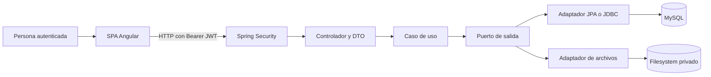

# Arquitectura general

Estado documental: actualizado desde el código auditado el 2026-11-06. Los resultados de pruebas citados corresponden a esa auditoría.

## Componentes implementados

Angular 19.2.25 es una SPA que consume la API REST Spring Boot 4.1.1/Java 21. La persistencia utiliza JPA y JDBC con MySQL como destino configurado. Los archivos se almacenan en filesystem, con referencias en BD.

El diagrama representa el diseño observado, no una topología de producción certificada. Proxy local: puerto 9090. Producción frontend: mismo origen por defecto. Nginx/TLS/firewall/servicios instalados no se comprobaron.

## Monolito modular

Un POM y una aplicación agrupan Identidad, Catálogos, Conocimiento, Procedimientos, Ejecución, Seguimiento y Tickets. Shared proporciona contratos y controles transversales. No son microservicios ni despliegues independientes.

Se comprueban puertos/adaptadores y dependencia hacia modelos/contratos en los recorridos inspeccionados. Tickets tiene seis reglas ArchUnit. En otros módulos existen DTO y entidades compartidas, servicios concretos y dependencia Spring en Application. No se declara hexagonal pura ni aislamiento automático de todo el monolito.

## Fuentes

`dima-bug-backend/pom.xml`, `BackendApplication.java`, paquetes `application/port`, `infrastructure/persistence/adapter`, `tickets/arquitectura/TicketsArquitecturaTest.java` y `frontend-dimabug/src/app/app.config.ts`.

## Referencias

[Índice vigente](../README.md) · Auditoría de origen (fuente en repositorio: `docs/auditoria/AUDITORIA_DOCUMENTAL.md`)
